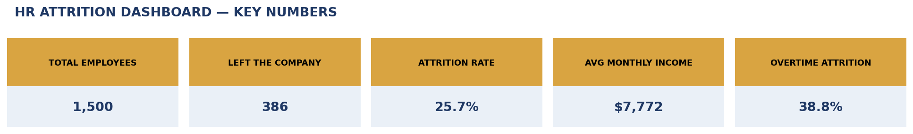
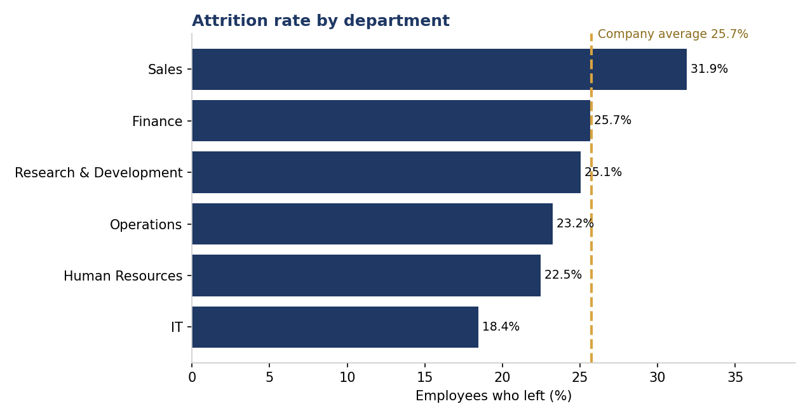

# HR Attrition Analytics — Excel Dashboard

**Why are employees leaving — and which levers actually change it?**

An end-to-end people-analytics project over **1,500 employees**: a cleaned dataset, an Excel dashboard with KPI cards and native charts, and a written analysis of the drivers of attrition.

## Headline numbers

| Metric | Value |
|---|---|
| Employees analysed | 1,500 |
| Left the company | 386 |
| **Overall attrition rate** | **25.7%** |
| Attrition with overtime | 38.8% |
| Attrition without overtime | 20.6% |
| Average monthly income — leavers | $7,511 |
| Average monthly income — stayers | $7,862 |

## Key findings

1. **Overtime is the single strongest signal.** Employees working overtime left at **38.8%**, versus 20.6% for everyone else — nearly double. Before hiring more people, the cheapest retention move is rebalancing workload.
2. **Sales is the problem department at 31.9% attrition** — well above the 25.7% company average and far above IT (18.4%). Target-driven pressure plus overtime is the classic burnout combination, and the data shows exactly that pattern.
3. **Job satisfaction works like a staircase:** attrition falls steadily from **32.3%** at the lowest satisfaction level to **20.4%** at the highest. Every step up in satisfaction buys a measurable drop in exits.
4. **Pay is NOT the main story.** Leavers earned only ~4.5% less than stayers on average ($7,511 vs $7,862) — a real gap, but far smaller than the overtime gap (38.8% vs 20.6%) and the satisfaction gap (32.3% vs 20.4%). A company that only raises salaries is treating the weakest cause.
5. With 386 exits in one period, even a 5-point cut in attrition would keep roughly **75 more employees** — at typical rehiring/training cost, that is the largest single saving in this entire analysis.

## Deliverable

`HR_Attrition_Dashboard.xlsx` — Dashboard sheet (5 KPI cards + 2 native Excel charts), Summary sheet (department / overtime / satisfaction tables feeding the charts), Data sheet (full cleaned dataset). Rebuild it any time with `build_dashboard.py`.

## Tools & skills

Microsoft Excel (dashboard design, native charts) · Python (pandas, openpyxl) · data cleaning · people analytics · business storytelling

## Files

| File | What it is |
|---|---|
| `data/employees.csv` | 1,500 synthetic employee records |
| `build_dashboard.py` | Builds the .xlsx dashboard from the data |
| `HR_Attrition_Dashboard.xlsx` | The dashboard deliverable |
| `screenshots/` | Dashboard overview + attrition-by-department chart |

> **Note:** the dataset is synthetic (generated for portfolio purposes with realistic attrition drivers built in). Every figure above is computed from it — no hand-written numbers, and no real employee data.

*Author: [Faheem Rind](https://github.com/orhandataanalyst) — Data Analyst · Excel · SQL · Python · Power BI*
